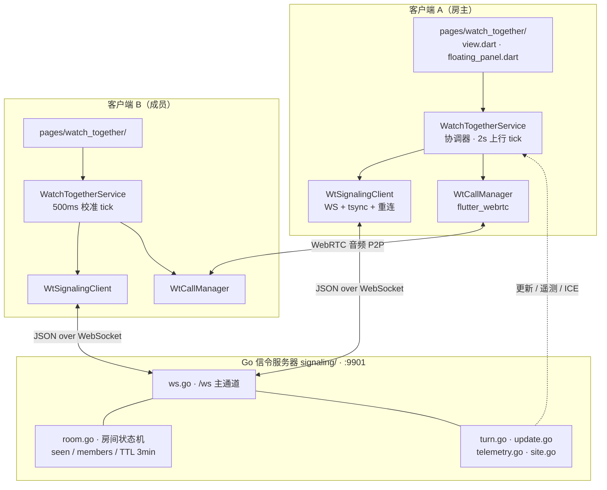
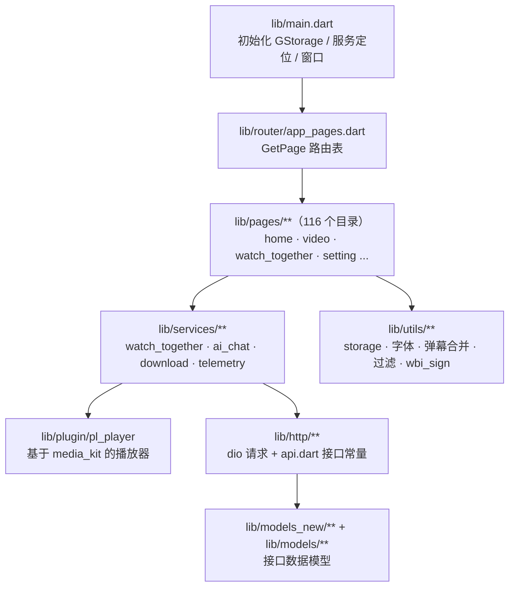
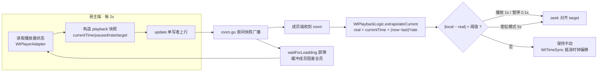
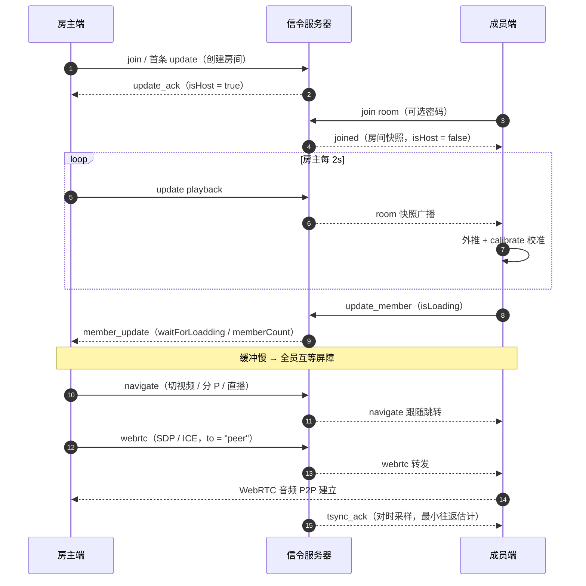
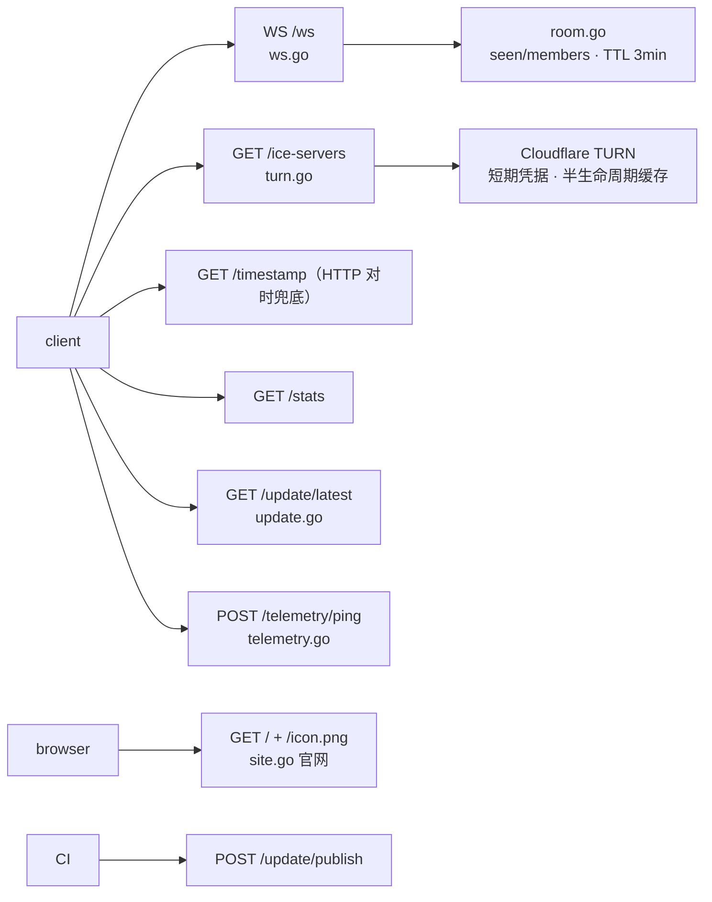
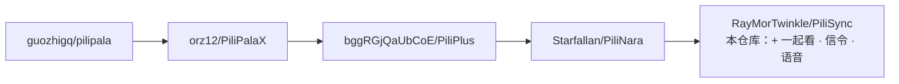

<div align="center">

> [English](./README_en.md) | **简体中文**


# PiliSync — 会「一起看」的 B 站第三方客户端

**把一个视频，变成一个房间。房间号一发，进度自动同步、双人语音通话。**

在 [PiliNara](https://github.com/Starfallan/PiliNara) / [PiliPlus](https://github.com/bggRGjQaUbCoE/PiliPlus) 的全部功能之上，PiliSync 加了一件事：**多人实时同步观影（Watch Together）+ WebRTC 语音**，并配了一个自研的 Go 信令服务器（`signaling/`）。


<sub>界面截图来自本应用（沿用上游品牌素材）</sub>

</div>

---

## 它解决什么问题

「和朋友一起看个视频」在 B 站官方客户端里几乎是空白：要么各看各的，要么靠手动对着进度条喊「你往回拖 5 秒」。第三方客户端（PiliPlus / PiliNara 系）功能很全，但同样没有同步播放。

**PiliSync 的做法是把播放状态做成一条房间内的单一事实流**：房主是唯一写者，每 2 秒把 `{currentTime, paused, playbackRate}` 广播到房间；成员端用本地时钟外推 + 校准算法对齐；缓冲慢的一方触发「互等屏障」，全员暂停等它。语音则走 WebRTC 点对点，只在对称 NAT 打不通时才用 Cloudflare TURN 中继。

> 协议语义对齐 [VideoTogether](https://github.com/VideoTogether/VideoTogether)（`room/update` 单写者、快照广播、客户端外推校准），传输为纯 **JSON over WebSocket**。

---

## ✨ 功能

**一起看 / Watch Together（本仓库核心新增）**

- 🎬 **房间制同步观影**：创建/加入房间（可选密码），房主切换视频、分 P、直播时全员跟随
- 🔊 **双人语音通话**：基于 `flutter_webrtc`，支持静音、扬声器切换、麦克风电平表与**语音门限**（低于阈值直接禁用音轨，不传噪声）
- ⏱️ **外推校准同步**：成员端按 `currentTime + (now − lastUpdateClientTime) × rate` 本地外推，播放态 1s / 暂停态 0.1s 阈值内不打扰，超出才 seek
- 🧱 **缓冲互等屏障**：有人缓冲时按房间目标页聚合「等待」状态，全员暂停等待；片尾缓冲不阻塞
- 🔀 **房主转让 / 夺权**：可手动转让房主；新连接以首条合法 `update` 夺权（兼容房主换 uuid 后重返房间）
- 🪟 **悬浮面板**：在小窗/任意页面挂着一起看面板，不中断当前浏览
- 🛡️ **宽松模式 / 房主优先**：偏远成员放宽到 5s 阈值并限制补帧频率；房主优先模式下成员状态永不反向拖动房主播放器

**继承自上游 PiliNara（非本 fork 独有，详见 [vs 上游](#-vs-上游)）**

- 📺 播放、小窗、字幕、弹幕、动态、直播等全套 PiliPlus 功能
- 🔤 自定义字体系统、合并弹幕（类 [Pakku.js](https://github.com/xmcp/pakku.js)）、弹幕屏蔽导入导出
- 🤖 AI 字幕分析（OpenAI 兼容 API）、离线缓存双视图、推荐/动态/评论过滤增强

**本仓库另加**

- 📦 **国内更新渠道**：更新弹窗默认走 `wt.raymor.top/update/latest`，GitHub Releases 降为备选
- 📊 **可选遥测**：启动一次 ping（可在设置底部关闭），只统计设备 ID / 版本 / 一起看次数与时长

---

## 🚀 快速开始

### 方式一：面向 AI Agent（一键安装，推荐）

把下面这段提示词直接发给你的本地 AI Agent（Claude Code / Codex / OpenCode …）：

````markdown
请帮我编译并运行 PiliSync（GitHub: https://github.com/RayMorTwinkle/PiliSync）。
背景：PiliSync 是基于 PiliNara/PiliPlus 的 B 站第三方客户端（Flutter），核心新增「一起看」同步观影 + WebRTC 语音。
环境：Flutter 3.47.5、Dart >= 3.13（见仓库根目录 .fvmrc）。构建前必须先按 docs/build.md 给 Flutter SDK 与 pub 缓存打补丁（原版 SDK 无法编译）。

步骤：
1. 克隆：git clone https://github.com/RayMorTwinkle/PiliSync.git && cd PiliSync
2. 拉依赖：flutter pub get
3. 编译 Android：flutter build apk --release --split-per-abi
4. （可选）编译桌面：flutter build macos --release / flutter build windows --release / flutter build linux --release
5. （可选）起信令服务端：cd signaling && go build -o signaling-server . && ./signaling-server  # 默认 :9901
6. 向用户确认编译结果，并说明「一起看」入口在「我的」页右上角图标。
````

### 方式二：面向人类用户

```bash
git clone https://github.com/RayMorTwinkle/PiliSync.git
cd PiliSync
flutter pub get
flutter build apk --release --split-per-abi        # Android（默认打包渠道）
# 桌面端：
# flutter build macos --release / flutter build windows --release / flutter build linux --release
```

> **环境要求**：Flutter **3.47.5**（`.fvmrc` 已锁定）、Dart SDK `>=3.13.0`。
> **⚠️ 构建前必读**：本 fork 无法直接用原版 Flutter 编译——必须先按 [docs/build.md](docs/build.md) 给 Flutter SDK 与 pub 缓存打补丁（含 iOS 模拟器 gt3 坑与 release 打包流程）。
> 桌面端与语音通话依赖各平台原生配置（macOS 主要走 CocoaPods 嵌入 WebRTC）。

### 自建信令服务器（可选，进阶）

```bash
cd signaling
go build -o signaling-server .        # Go 1.21+，唯一外部依赖 gorilla/websocket
./signaling-server                    # 默认监听 :9901
# 或容器化：
docker build -t pilisync-signaling signaling/
```

客户端「一起看」页可填自定义服务器地址（默认 `wss://wt.raymor.top`）。

---

## 🖥️ 使用

### 一起看：房主视角

```text
1. 「我的」页右上角 → 一起看（或设置页入口）
2. 填服务器地址（默认 wss://wt.raymor.top）→「创建房间」
3. 把房间号发给好友（可设密码）
4. 正常打开任意视频 —— 你的播放态会被广播，成员自动跟随
5. 点「语音」发起通话；缓冲慢的成员会触发全员互等
```

### 一起看：成员视角

```text
1. 同样进入「一起看」页 → 输入房间号（如有密码一并填）→「加入」
2. 客户端自动跟随房主：切换视频 / 进度 / 暂停 / 倍速
3. 想自己看？退出房间即可；网络抖动时客户端自动重连并从快照恢复
```

### 关键设置项（存储键）

| 设置 | 存储键 | 说明 |
|---|---|---|
| 服务器地址 | `wtServerUrl` | 默认 `wss://wt.raymor.top` |
| 更新渠道 | `updateChannel` | 国内 / GitHub 可选（默认国内渠道）|
| 宽松模式 | `wtLooseSync` | 追不上时限流补帧、放宽到 5s 阈值 |
| 房主优先 | `wtHostPriority` | 成员状态永不拖动房主播放器 |
| 语音门限 | `wtVoiceGate` | 低于阈值的静音直接不发声 |
| 悬浮面板 | `wtFloatingPanel` | 跨页面挂着一起看面板 |
| 遥测开关 | `telemetryEnabled` | 「其他设置」底部可关闭 |

---

## 🏗️ 架构

### 系统总览

两个客户端通过同一个 Go 信令服务器交换播放快照，语音则走 WebRTC 点对点（仅 NAT 打不通时经 TURN 中继）。



### Flutter 客户端分层



### 同步数据流

房主是唯一写者，成员端「外推 → 比对 → 必要时 seek」，缓冲状态经服务端聚合成全员屏障。



### 关键流程时序（进房 → 同步 → 语音）



### 信令服务器模块与路由



### 来源谱系



> ℹ️ **关于 fork 关系**：本仓库的上游历史最初被压平为单个根提交（`9e645c99e`），GitHub compare 曾报「无共同祖先」。2025-10-08 合并上游 `nara/main`（约 668 个提交）后血缘已连通——compare 现显示 **diverged · ahead 51 / behind 92**（merge-base `1807e22ed`）。下述「vs 上游」数据均来自本地实测与 GitHub compare API。

---

## 📂 目录结构

```text
PiliSync/
├── lib/                         # Flutter 客户端
│   ├── main.dart                # 应用入口（GStorage / 服务定位 / 窗口）
│   ├── router/app_pages.dart    # GetPage 路由表（含 /watchTogether）
│   ├── pages/                   # 116 个页面目录
│   │   └── watch_together/
│   │       ├── view.dart        # 一起看主页（建房 / 加入 / 语音）
│   │       └── floating_panel.dart  # 跨页面悬浮面板
│   ├── services/
│   │   ├── watch_together/       # ★ 一起看核心
│   │   │   ├── watch_together_service.dart  # 协调器（房主/成员 tick）
│   │   │   ├── wt_signaling_client.dart     # WS + tsync + 重连
│   │   │   ├── wt_call_manager.dart         # WebRTC 语音
│   │   │   ├── wt_member_coordinator.dart   # 成员校准
│   │   │   ├── wt_playback_coordinator.dart # 房主屏障意图
│   │   │   ├── wt_sync_logic.dart           # 对时 + 外推 + calibrate（纯逻辑）
│   │   │   ├── wt_player_port.dart          # WtPlayerAdapter 端口接口
│   │   │   ├── wt_player_adapter.dart       # PlPlayerAdapter 实现 + 命令源接口
│   │   │   ├── wt_models.dart               # 消息/快照模型
│   │   │   └── wt_debug_server.dart         # 调试控制面（仅 kDebugMode）
│   │   ├── ai_chat/ telemetry/ download/ ...
│   ├── scripts/                 # Flutter SDK / pub 缓存补丁（构建前置，见 docs/build.md）
│   ├── plugin/pl_player/        # media_kit 播放器
│   ├── http/ · models_new/ · utils/
├── signaling/                   # ★ Go 信令服务器
│   ├── ws.go                    # WS 主通道（1MB 帧限，ping 54s / pong 120s）
│   ├── room.go                  # 房间状态机（TTL 3min，心跳 15s）
│   ├── turn.go                  # Cloudflare TURN 短期凭据代取
│   ├── update.go                # 国内更新渠道（/update/latest · /update/publish）
│   ├── telemetry.go             # 遥测接收
│   ├── site.go                  # 官网首页 + 应用图标
│   ├── Dockerfile · cmd/probe/  # 容器与连接探针
│   └── README.md                # 协议参考（消息表 + 关键语义）
├── tool/                        # wt_mirror / wt_connection_probe / wt_host_driver 等
├── docs/build.md                # ★ 构建指南：Flutter SDK 补丁 / iOS 模拟器坑 / release 打包
├── test/watch_together/         # 一起看单测 + 信令 E2E（11 个测试文件）
├── android/ ios/ macos/ windows/ linux/
└── pubspec.yaml                 # version: 2.9.3 · Flutter 3.47.5（.fvmrc 锁定）
```

---

## 🔧 技术细节

**对时（NTP 式最小往返估计）。** `WtTimeSync.updateIfNeeded()` 只在往返更小时更新：
`offset = serverTimestamp − (localStart + localEnd) / 2`，成员据此把服务端时钟换算到本地。

**外推与校准。** `WtPlaybackLogic.extrapolateCurrent()` 计算
`real = currentTime + (now − lastUpdateClientTime) × playbackRate`，并 clamp 到 `[0, duration]` 防止时钟偏移越界。
`calibrate()` 在播放态用 **1.0s**、暂停态用 **0.1s** 阈值，宽松模式播放态放宽到 **5s**；缓冲中的成员**不 seek**（seek 会清空正在填充的缓冲，形成延迟放大循环），待就绪后一次性对齐。

**tick 频率与阈值。** 房主循环 **2s**、成员循环 **500ms**；loading 上报上限 **20s**、loading 停留 **1.5s**、房主缓冲停留 **1.0s**；`navigate` 重试间隔 **10s**、最多 **5** 次。

**存储键（Hive setting box）。** `wtServerUrl` · `wtLooseSync` · `wtHostPriority` · `wtVoiceGate` · `wtRemoteVolume` · `wtFloatingPanel` · `wtWelcomed` · `telemetryEnabled` · `telemetryDeviceId` · `telemetryOpenCount` · `wtSessionCount` · `wtSessionSecs`。

**服务端房间语义。** `hostId`/房主 uuid 是**写权限凭证**，快照永不下发；客户端只通过 per-recipient `isHost` 得知角色。房间 `roomExpire = 3min` 无 update 自动回收、`cleanupInterval = 30s`、`memberHeartbeatTTL = 15s`、`hostHandoverGrace = 20s`、`maxMemberLoadingWait = 60s`；回收前先排空发送队列再断连，保证 `room_closed` 可达。

**连接与限流。** WS 单条消息上限 **1MB**、`pingPeriod = 54s` / `pongWait = 120s`；房间数上限 10000、连接数上限 5000、单连接令牌桶限流、聊天 UTF-8 安全截断至 **500** 字符；半开连接（NAT 切换无 FIN）靠入站静默 **12s** 判定死亡并重连。

**TURN 代取。** TURN 长效密钥只放服务端：`GET /ice-servers` 由服务端向 Cloudflare 换取**短期 ICE 凭据**再下发，客户端永远拿不到 token；未配置时回退 STUN-only，上游失败先吃缓存再降级。

**遥测边界。** 每次启动 `POST https://wt.raymor.top/telemetry/ping`，只收集 `device_id / version / build_time / mid / uname / open_count / wt_count / wt_secs`，IP 与属地由服务端推导，设置底部可关闭。

**调试控制面。** `wt_debug_server.dart` 在 **kDebugMode** 下监听 **loopback :9911**，供外部测试驱动直接建房/跳转/读状态，release 构建会被编译剔除。

**构建补丁（继承上游的魔改 Flutter）。** 代码引用了原版 SDK 不存在的框架符号（`horizontalDragGestureRecognizer`、定制滚动物理、文本选择行为等），必须先打补丁再编译：三层补丁清单在 `lib/scripts/`（SDK 本体 ~21 个 + pub 缓存 `material_ui`/`cupertino_ui` + iOS 专用 repo 侧补丁），`patch.ps1` 为 Windows 入口，macOS/Linux 用 `git apply` 等价执行——完整流程见 [docs/build.md](docs/build.md)；pubspec.lock 当前锁定的对齐版本为 `material_ui 1.4.0` / `cupertino_ui 1.0.1` / `protobuf 6.1.0`（补丁按版本路径打，升包后需重打）。

---

## ❓ 常见问题

**Q：一起看需要登录吗？语音要开摄像头吗？**
A：一起看本身只需能播放视频；语音只传输**音频**（麦克风），不涉及摄像头。

**Q：听不到对方 / 连不上语音？**
A：语音先走 WebRTC 点对点；对称 NAT 下依赖 TURN 中继。若自建服务器未配 TURN（`TURN_KEY_ID` / `TURN_API_TOKEN`），则只有 STUN，部分网络会连不上。

**Q：成员进度老是差一点 / 一台设备卡？**
A：这是缓冲屏障在起作用：慢的一方会触发全员暂停等待。可开启「宽松模式」放宽到 5s 并限制补帧频率，避免慢网络被反复清空缓冲。

**Q：为什么更新弹窗默认走非 GitHub 的地址？**
A：国内访问 `api.github.com` 不稳定，`wt.raymor.top/update/latest` 由免费对象存储直链分发，GitHub Releases 作为备选。

**Q：会不会偷偷上报数据？**
A：遥测是**可关**的，只上报聚合计数（见「技术细节 · 遥测边界」），不传聊天内容和视频信息。

---

## ⚠️ 注意事项

- 本仓库为**个人自用 fork**，作者自述「开发水平有限」，BUG 可能不少，欢迎 issue/PR。
- 官方只保证打包 Android；桌面端（macOS/Windows/Linux）与 iOS 请自行编译，语音在不同平台的原生配置可能需要额外调通。
- 语音通话涉及**麦克风权限**与实际网络；具有对称 NAT 的网络需依赖 TURN 中继才能接通。
- 同时观看的视频需**各自客户端均可播放**（会员/版权内容受各自账号限制）。
- 本项目仅供学习测试，请于下载后 24 小时内删除；所用 API 均来自官方公开接口，不提供任何破解内容。

---

## 📄 License

[GNU General Public License v3.0](./LICENSE)（沿用上游 PiliNara / PiliPlus 的许可）。

> 需要说明的是：本项目作为 PiliPlus 的下游衍生作品，其许可与上游一脉相承，同样为 GPL-3.0。

---

## 🔀 vs 上游

**上游链条**：`guozhigq/pilipala` → `orz12/PiliPalaX` → `bggRGjQaUbCoE/PiliPlus` → `Starfallan/PiliNara` → **`RayMorTwinkle/PiliSync`（本仓库）**。

一句话：**PiliSync = PiliNara + 一起看（含自研信令/语音）+ 国内更新渠道 + 遥测 + 各平台改名共存。**

> 📌 **同步状态（2025-10-08 合并后）**：本仓库已合并上游 `nara/main` 约 **668** 个提交（merge commit `c3beba2d`），随后完成合并善后（重复声明去重、`playerStatusStream` 端口、pb/scroll_view/get 依赖对齐）并 bump 到 **2.9.3**。当前相对 `upstream/main`：**ahead 51 / behind 92**——上游仍在活跃演进（其版本线已到 `2.1.6+1`，Flutter 3.47.7），后续会择机再合并。

### 本 fork 相对上游的真实增量

| 维度 | 上游 `Starfallan/PiliNara` | 本仓库 `PiliSync` |
|---|---|---|
| 应用显示名 | PiliNara | **PiliSync**（Android label / macOS `PRODUCT_NAME` / Windows 窗口标题均已替换，便于共存）|
| 版本线 | `2.1.6+1`（上游主线，Flutter 3.47.7） | **`2.9.3`**（fork 自发版号线，Flutter 3.47.5）|
| 服务端 | 无（纯客户端） | **新增 `signaling/` Go 服务器**：一起看信令 + 更新渠道 + 遥测 + 官网 |
| 同步观影 | 无 | **房间制同步 + WebRTC 语音**（对齐 VideoTogether 语义）|
| 更新渠道 | GitHub Releases | **国内直连** `wt.raymor.top/update/latest` + 设置内渠道切换（`updateChannel`），GitHub 降为备选 |
| 遥测 | 无 | **可选**启动 ping（可关闭）|
| 构建/部署 | Android 为主 | 补 mac/win_x64 一键 tag 发版、Docker 化信令、国内分发链路 |
| 文档 | README | 中英双语展示级 README + `signaling/README.md` 协议参考 + `docs/build.md` 构建指南 |

### 精确 diff（合并后血缘已连通，可实测）

以下数字来自 `git diff upstream/main...HEAD`（merge-base→HEAD 的全部 fork 改动），并与 GitHub compare API 核对一致：**146 个文件，+13,362 / −1,420**。

| 分组 | 文件数 | 增删 | 内容 |
|---|---|---|---|
| `signaling/` | 16 | +4,500 | Go 信令服务器全部（ws/room/turn/update/telemetry/site + 1,432 行服务端测试）|
| `lib/services/watch_together/` | 10 | +3,213 | 一起看客户端核心（协调器/WS 客户端/通话/同步逻辑/播放器端口）|
| `test/watch_together/` | 11 | +1,920 | 一起看单测与 WS 协议 E2E |
| `lib/pages/watch_together/` | 2 | +835 | 一起看页面 + 悬浮面板 |
| `lib/services/telemetry/` | 1 | +103 | 遥测服务 |
| `tool/` | 4 | +409 | wt_mirror / wt_connection_probe / wt_host_driver 调试驱动 |
| `.github/workflows/` | 8 | +148/−76 | mac/win_x64 发版流水线、PR 条件改为本仓库名等 |
| `lib/` 其他 | 64 | +997/−615 | 播放器端口接入、设置项、更新渠道、`playerStatusStream` 等合并善后残差 |
| `android/ ios/ macos/ windows/ linux/` | 20 | +106/−110 | PiliSync 改名、macOS WebRTC 嵌入、Windows 打包配置 |
| 根目录 / docs / 其他 | 10 | +1,131/−618 | 中英 README、`docs/build.md`、pubspec、CHANGELOG 裁剪等 |

### 通过 `git log` 得到的直接证据

`upstream/main..HEAD` 共 **51 个提交**（46 个作者为 RayMorTwinkle、1 个压平上游根提交、4 个合并善后与文档提交），主题集中在：

```text
feat: watch-together core (signaling server + dart client + ui)
feat(wt): voice call (M5)
fix(wt): member sync freeze + host pause intent (device round 3 root causes)
feat(wt): spec1 全量修复 + TURN 代取 + 公网信令部署配置 + PiliSync 改名
feat: domestic update channel + telemetry
feat: landing page at / — PiliSync public site
ci: 发版默认构建 mac + win_x64（一键 tag 出全平台）
fix(watch-together): F12 deep-review — 26 verified defects fixed
WT: host-priority mode — member state never moves the host player
Merge nara/main (PiliPlus upstream ~668 commits) into PiliSync
fix merge fallout: dedup declarations, restore upstream mixin structure, add playerStatusStream
docs: build guide covering Flutter SDK patch requirement, iOS sim gotchas, release packaging
```

→ 均指向同一结论：**本 fork 的增量就是「一起看 + 信令 + 语音 + 更新/遥测/官网 + 构建部署」**。

### 需要如实澄清的部分

- **小窗、AI 字幕、合并弹幕、自定义字体、备注、推荐/动态/评论过滤、离线缓存双视图等，均由上游 PiliNara 提供**，并非本 fork 新增。本 README 的「功能」列表已按此分节标注。
- 上表数字是对 `upstream/main` 当前快照（2025-10-09）的实测；上游再推进后 behind 数与 diff 明细会变化，以 `git diff upstream/main...HEAD` 复测为准。

---

## 🙏 致谢 / Credits

本仓库建立在一长串开源工作之上，致敬每一位上游作者：

- **[bggRGjQaUbCoE/PiliPlus](https://github.com/bggRGjQaUbCoE/PiliPlus)** — 直接上游的根基（本项目的大量页面、服务与组件源自它）
- **[Starfallan/PiliNara](https://github.com/Starfallan/PiliNara)** — 本 fork 的直接父仓库
- **[orz12/PiliPalaX](https://github.com/orz12/PiliPalaX)** 与 **[guozhigq/pilipala](https://github.com/guozhigq/pilipala)** — 更早的开源血脉
- **[VideoTogether](https://github.com/VideoTogether/VideoTogether)** — 一起看协议语义参考
- **[naaammme/pilipro](https://github.com/naaammme/pilipro)** — 应用内小窗逻辑参考
- **[xmcp/pakku.js](https://github.com/xmcp/pakku.js)** — 合并弹幕算法参考
- **[SocialSisterYi/bilibili-API-collect](https://github.com/SocialSisterYi/bilibili-API-collect)** — B 站接口文档
- **[media-kit/media-kit](https://github.com/media-kit/media-kit)** · **[dio](https://pub.dev/packages/dio)** · **[flutter_webrtc](https://github.com/flutter-webrtc/flutter-webrtc)** · **[gorilla/websocket](https://github.com/gorilla/websocket)** 等依赖

---

<div align="center">
<sub>PiliSync · 同一个视频，同一个进度，同一段笑声</sub>
</div>
