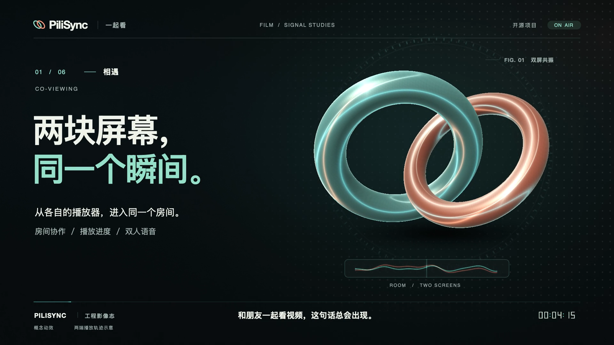
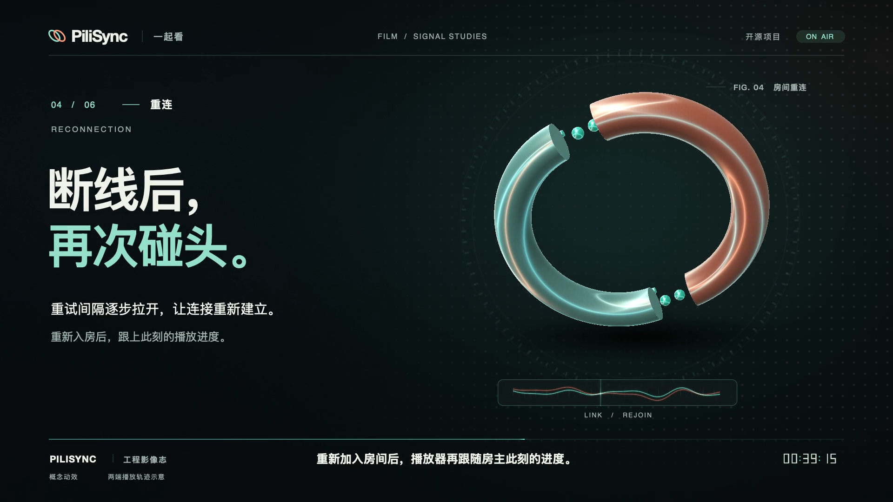
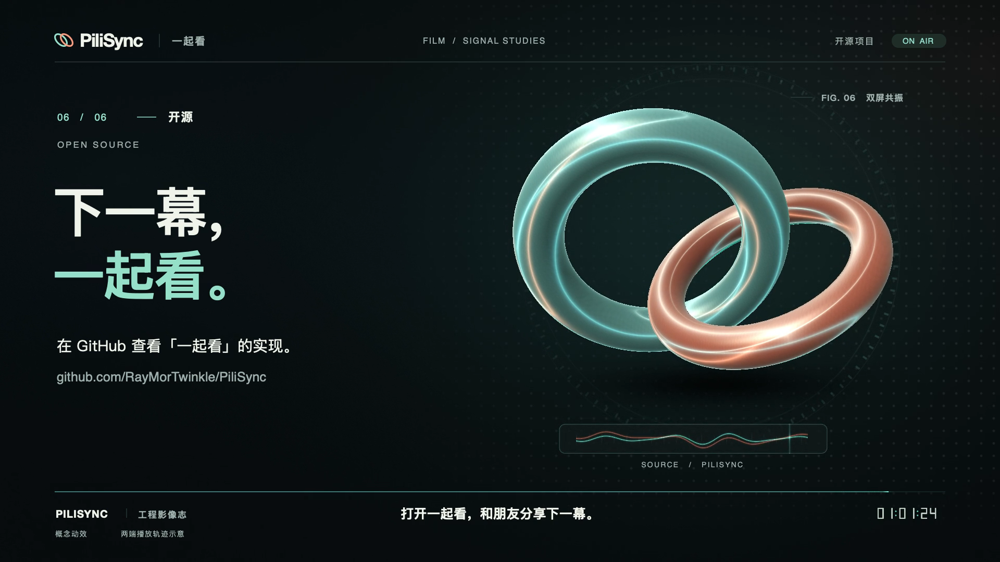

<div align="center">


# PiliSync

### 两块屏幕，同一个瞬间。

**和朋友一起看视频，不必再一遍遍问「你看到哪儿了？」**

[](https://flutter.dev/)
[](signaling/README.md)
[](LICENSE)
<br>
[](https://raymortwinkle.github.io/PiliSync/)
[](https://raymortwinkle.github.io/PiliSync/media/promo.mp4)
[](https://github.com/RayMorTwinkle/PiliSync)

[✨ 在线交互体验站](https://raymortwinkle.github.io/PiliSync/) · [🎬 观看中文宣传片](https://raymortwinkle.github.io/PiliSync/media/promo.mp4) · [🚀 3 分钟上手](#quick-start) · [📊 实测对比](#evaluation) · [🏗️ 核心架构](#architecture)

</div>

<div align="center">
  <a href="https://raymortwinkle.github.io/PiliSync/media/promo.mp4"></a>
  <p><strong>▶ 点击封面观看中文宣传片</strong> · <a href="https://raymortwinkle.github.io/PiliSync/">打开在线交互体验站 ↗</a></p>
  <video controls width="100%" poster="docs/media/promo-poster.jpg" src="https://raymortwinkle.github.io/PiliSync/media/promo.mp4">
    <a href="https://raymortwinkle.github.io/PiliSync/media/promo.mp4">观看 PiliSync 中文宣传片</a>
  </video>
  <p><sub>GitHub 页面可能不显示内嵌播放器；点击封面或视频链接即可观看。</sub></p>
</div>

<table>
  <tr>
    <td align="center" width="50%"><br><strong>断线后，再次碰头。</strong><br><sub>重新入房，跟上此刻的进度。</sub></td>
    <td align="center" width="50%"><br><strong>下一幕，一起看。</strong><br><sub>打开源码，看看房间如何运转。</sub></td>
  </tr>
</table>

> 🎬 以上是宣传片的概念视觉帧，展示的是功能理念，并非客户端界面截图。

## 💡 为什么做它？

想和远方的朋友一起看视频，却总有人先笑了、有人还在缓冲，暂停一次又要重新对进度。PiliSync 是一个带「一起看」功能的 Flutter 客户端：房主创建房间，朋友用房间号加入，播放进度和操作由房间协调。各自的播放器加载各自有权观看的视频，还可以边看边聊。

## ✨ 核心亮点

- 🎬 **一起播放，也一起暂停** — 房主控制播放，成员跟随进度；切换视频、分 P 或直播页时也能跟随导航。
- ⏳ **等等还在缓冲的朋友** — 常规模式支持缓冲互等；宽松模式允许进度留有余量，也可选择房主优先。
- 🎙️ **边看边聊** — 双人 WebRTC 语音支持静音、扬声器和语音门限调节。
- 🔄 **断线后接着看** — 重连后重新读取房间快照；悬浮面板让你离开播放页也能操作房间。
- 🧩 **熟悉的观看体验** — 在上游 PiliNara / PiliPlus 系列的基础上，保留视频、直播、弹幕、字幕和离线缓存等功能。
- 🛠️ **房间服务可自建** — Go 信令服务负责房间与消息，客户端支持自定义服务器地址。

<details>
<summary><strong>🎟️ 怎么和朋友加入同一个房间？</strong></summary>

双方进入「我的」页右上角的「一起看」。房主创建房间，将房间号和可选密码发给朋友；成员加入后，房主照常播放即可。想聊天时，点击「语音」发起双人通话。

</details>

<a id="architecture"></a>
## 🏗️ 工作原理

房主发出播放意图，房间服务广播快照；成员结合对时、缓冲和本地播放器状态，决定是否跳转、调速或播放。视频由各端自行加载，语音通话有独立的状态流程。


从源码继续探索：[房主协调器](lib/services/watch_together/wt_playback_coordinator.dart) · [成员协调器](lib/services/watch_together/wt_member_coordinator.dart) · [同步逻辑](lib/services/watch_together/wt_sync_logic.dart) · [信令服务](signaling/README.md)

<a id="evaluation"></a>
## 📊 实测改善：一次暂停，应该停在同一幕

如果成员在第 20 秒、房主在第 10 秒，成员可能先暂停等待。当房主也按下暂停，重构前的回放仍停在等待状态；重构后，成员收到 `seek:10000`，回到房主的暂停位置。

| 固定夹具通过数 | 重构前 | 重构后 | 检查什么 |
| --- | ---: | ---: | --- |
| 🎯 Dart 成员播放轨迹 | 7 / 15 | **15 / 15** | 播放器命令、加载回调与 seek 后状态 |
| 🔌 Go 房间契约 | 8 / 14 | **14 / 14** | 回环 WebSocket 的快照与缓冲等待标记 |

<details>
<summary><strong>查看测试口径与限制</strong></summary>

这些数字是同条件下固定夹具的通过数，用例特意覆盖边界和相邻反例，并非线上用户抽样。它们不能用来估计问题发生概率，也没有测量公网延迟、帧级同步精度、原生解码器、音质或设备能耗。两组结果应分别解读。

完整 Flutter 套件基线为 104/104、候选为 105/105，候选多出的测试复用了成员轨迹夹具，因此分母不同，不能与上表混用。两侧使用了相同的临时测试锁补丁；原锁缺少清单已声明的 `gt3_flutter_plugin 0.1.0`。首次各有一个测试超时，按相同条件复跑后通过。具体环境、原始记录与限制见[完整评测报告](docs/evals/refactor-1126-report.md)。

</details>

<a id="quick-start"></a>
## 🚀 3 分钟本地跑起来

**先启动房间信令服务**：准备好 Git 和 Go（`signaling/go.mod` 要求 Go 1.21），然后在终端运行：

```sh
git clone https://github.com/RayMorTwinkle/PiliSync.git
cd PiliSync/signaling
go run .
```

服务默认监听 `:9901`。这是房间服务，不是完整客户端；客户端可在「一起看」页面配置自定义服务器。想先直观体验同步决策？打开[在线交互体验站](https://raymortwinkle.github.io/PiliSync/)即可。

<details>
<summary><strong>📱 构建完整 Flutter 客户端</strong></summary>

完整应用需要项目锁定的 **Flutter 3.47.5**，并须为 Flutter SDK 和对应依赖应用项目补丁；原版 SDK 无法直接编译。先阅读[构建指南](docs/build.md)，完成环境准备与补丁后，在仓库根目录执行：

```sh
flutter pub get
flutter test
flutter build apk --release --split-per-abi
```

语音还需要对应平台的原生 WebRTC 组件和麦克风权限。不同平台的补丁与构建细节以[构建指南](docs/build.md)为准。

</details>

## 📚 延伸阅读 & 许可

- ✨ [在线交互体验站](https://raymortwinkle.github.io/PiliSync/) · 🎬 [中文宣传片](https://raymortwinkle.github.io/PiliSync/media/promo.mp4)
- 📊 [完整评测报告](docs/evals/refactor-1126-report.md) · 🏗️ [构建指南](docs/build.md) · 🔌 [信令服务说明](signaling/README.md)
- 📖 [English guide](README_en.md) · 📝 [更新记录](CHANGELOG.md) · 🌐 [Ray 的个人主页](https://raymor.top)
- ⚖️ 本项目采用 [GPL-3.0 协议](LICENSE)。

## 🙏 致谢

PiliSync 建立在许多开源项目之上。感谢直接父仓库 [PiliNara](https://github.com/Starfallan/PiliNara)、上游 [PiliPlus](https://github.com/bggRGjQaUbCoE/PiliPlus)，以及更早的 [PiliPalaX](https://github.com/orz12/PiliPalaX) 和 [PiliPala](https://github.com/guozhigq/pilipala)。一起看协议语义参考了 [VideoTogether](https://github.com/VideoTogether/VideoTogether)，也感谢 [pilipro](https://github.com/naaammme/pilipro)、[pakku.js](https://github.com/xmcp/pakku.js)、[bilibili-API-collect](https://github.com/SocialSisterYi/bilibili-API-collect) 及所有依赖项目的贡献者。

<div align="center">

**如果 PiliSync 让你想起了某个可以一起看的人，欢迎点一颗 ⭐ Star。**

下一幕，见。

</div>
