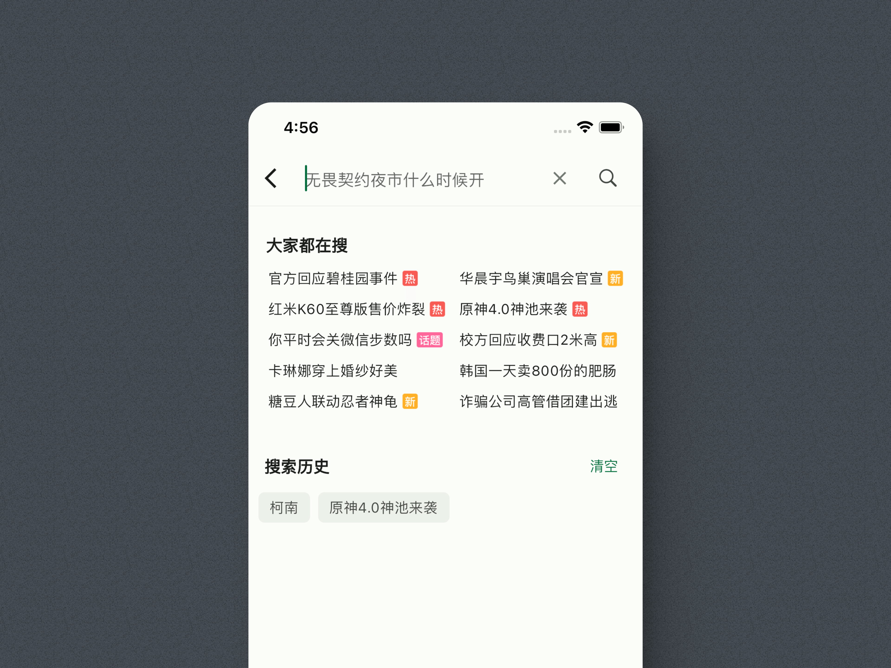
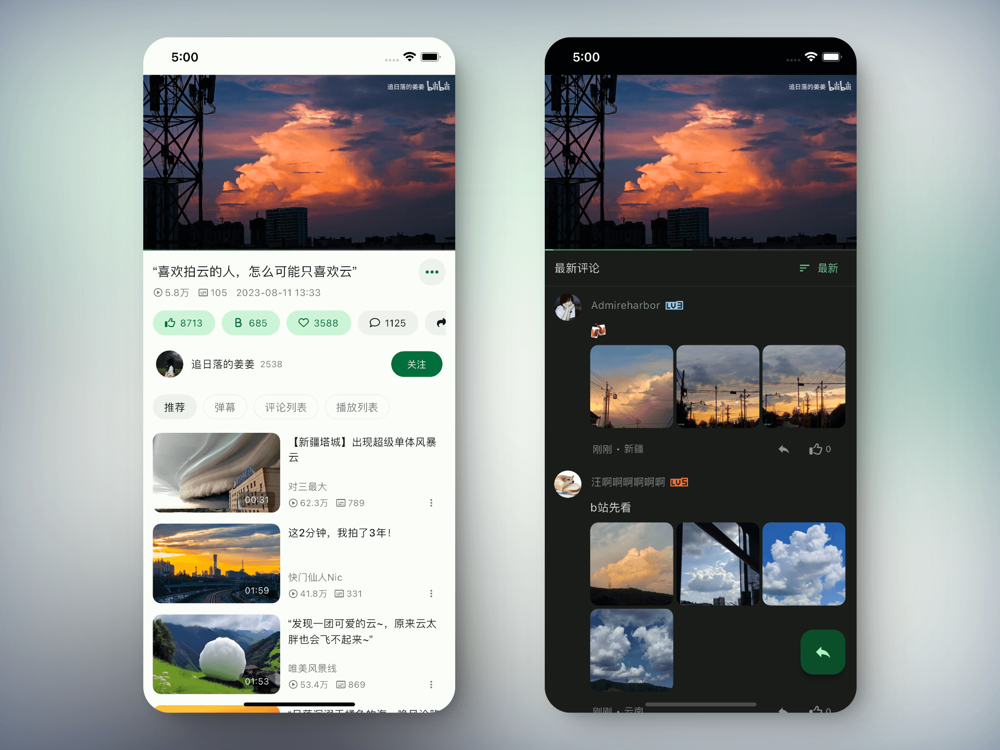
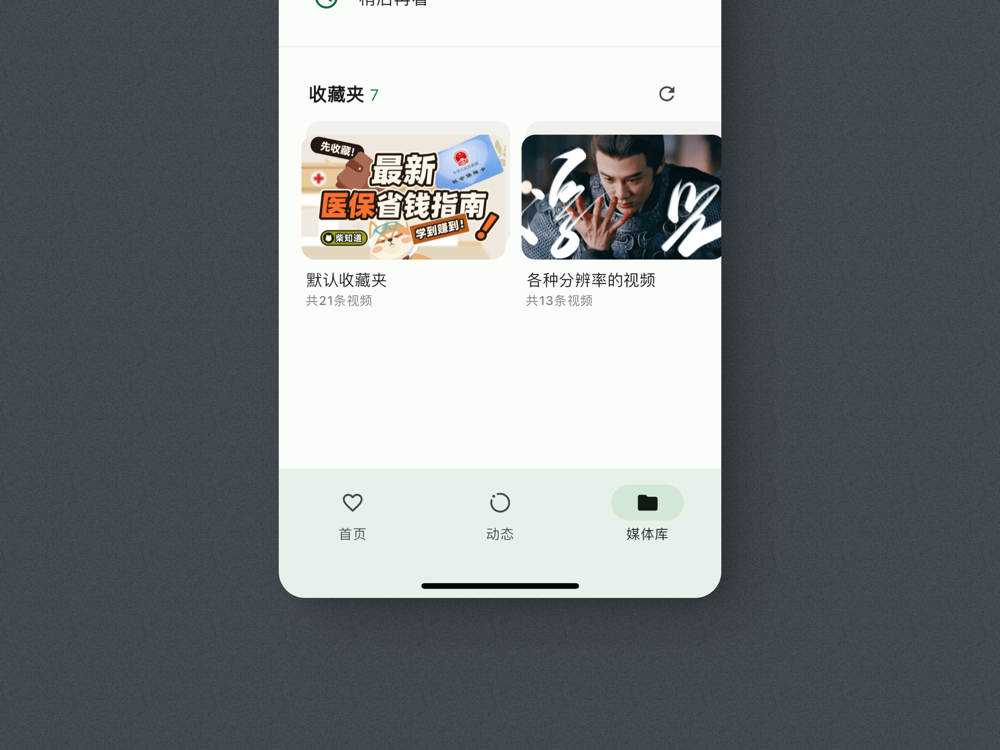
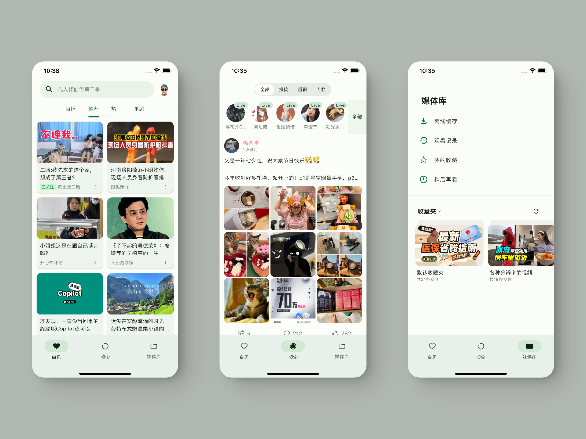
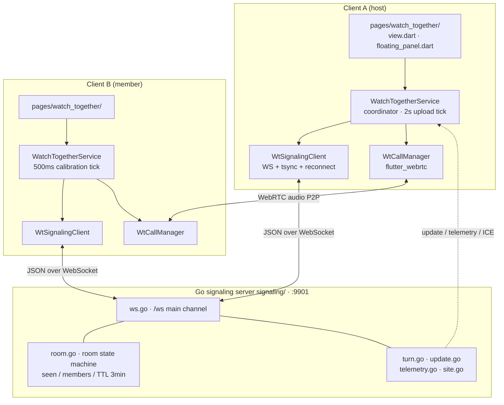
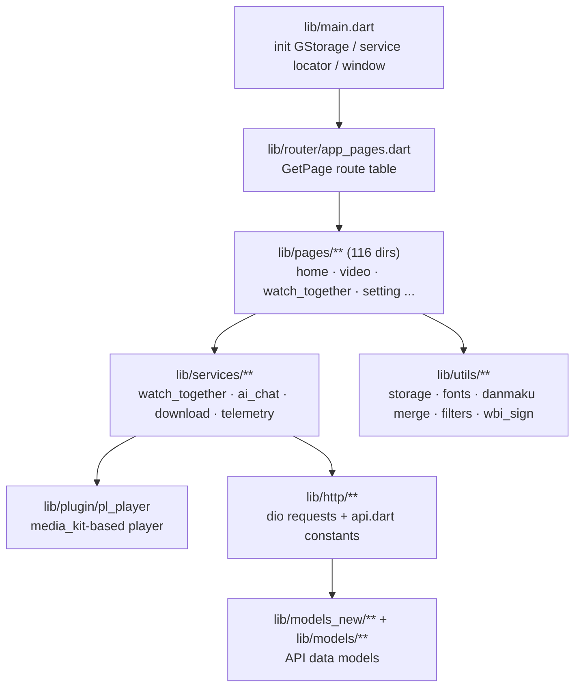
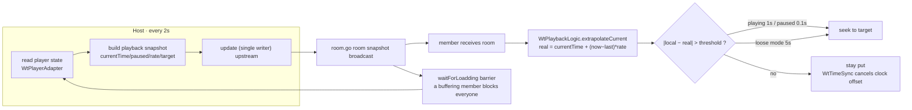
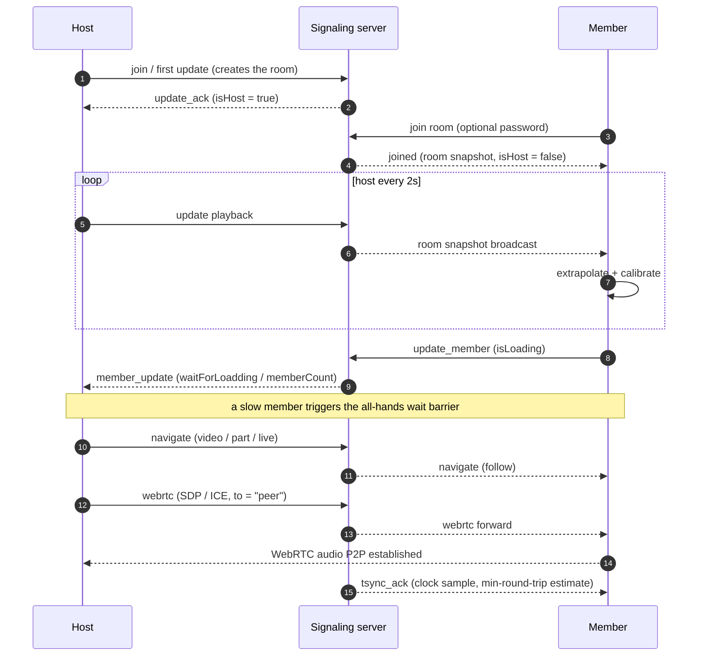
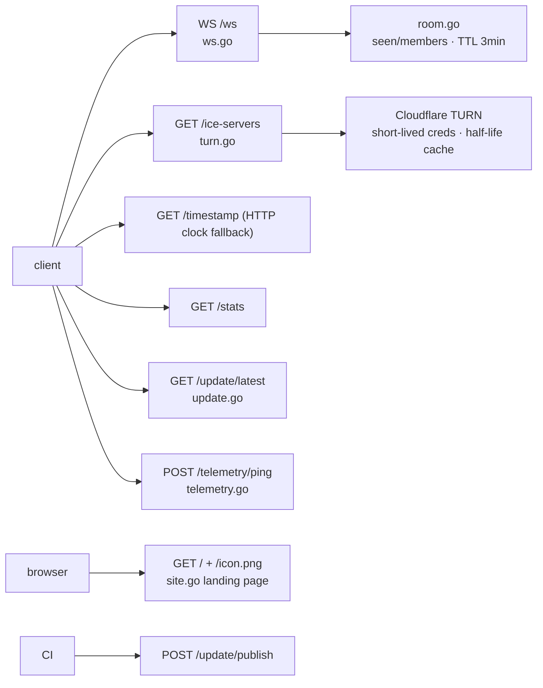
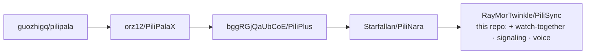

<div align="center">

> [简体中文](./README.md) | **English**


# PiliSync — a Bilibili client that can "watch together"

**Turn one video into a room. Share a room code and you're synced, with two-way voice.**

On top of everything in [PiliNara](https://github.com/Starfallan/PiliNara) / [PiliPlus](https://github.com/bggRGjQaUbCoE/PiliPlus), PiliSync adds one thing: **multi-user synchronized playback (Watch Together) + WebRTC voice**, plus a self-built Go signaling server (`signaling/`).







<sub>App screenshots (reusing upstream brand assets)</sub>

</div>

---

## Why it exists

"Watching a video together" is nearly absent from Bilibili's own app: you either watch separately, or you yell "drag it back 5 seconds" at each other. Third-party clients (the PiliPlus / PiliNara family) are feature-rich but have no synced playback either.

**PiliSync turns playback state into a single source of truth inside a room**: the host is the only writer and broadcasts `{currentTime, paused, playbackRate}` every 2 seconds; members extrapolate with their local clock and align via a calibration algorithm; a slow/ buffering member triggers a **mutual-wait barrier** that pauses everyone. Voice is WebRTC peer-to-peer, falling back to a Cloudflare TURN relay only when symmetric NAT blocks the direct path.

> The protocol semantics align with [VideoTogether](https://github.com/VideoTogether/VideoTogether) (single-writer `room/update`, snapshot broadcast, client-side extrapolation), carried as plain **JSON over WebSocket**.

---

## ✨ Features

**Watch Together (the core addition of this repo)**

- 🎬 **Room-based sync playback**: create/join a room (optional password); host switching video, part or live room is followed by everyone
- 🔊 **Two-way voice**: built on `flutter_webrtc`, with mute, speaker toggle, a live mic-level meter and a **voice gate** (below the threshold the audio track is disabled entirely — noise is never sent)
- ⏱️ **Extrapolation-based sync**: members compute `currentTime + (now − lastUpdateClientTime) × rate` and only seek beyond a 1s (playing) / 0.1s (paused) tolerance
- 🧱 **Buffering barrier**: when someone buffers, the server aggregates the "waiting" state for the room's current target and everyone pauses; end-of-video buffering does not block
- 🔀 **Host transfer / takeover**: manual host transfer; a fresh connection takes over with its first valid `update` (so a host that returns with a new uuid gets the room back)
- 🪟 **Floating panel**: keep the Watch Together panel over any page without losing your browsing
- 🛡️ **Loose mode / host-priority**: far-behind members get a 5s tolerance with rate-limited catch-up; in host-priority mode a member's state never moves the host player

**Inherited from upstream PiliNara (not unique to this fork — see [vs upstream](#-vs-upstream))**

- 📺 The full PiliPlus feature set: playback, PiP, subtitles, danmaku, dynamics, live, etc.
- 🔤 Custom font system, merged danmaku (à la [Pakku.js](https://github.com/xmcp/pakku.js)), import/export of the danmaku blocklist
- 🤖 AI subtitle analysis (OpenAI-compatible APIs), dual-view offline cache, enhanced recommend/dynamic/comment filters

**Also added in this repo**

- 📦 **Domestic update channel**: the update dialog defaults to `wt.raymor.top/update/latest`, with GitHub Releases as a fallback
- 📊 **Optional telemetry**: one ping per launch (toggle at the bottom of settings) counting only device ID / version / Watch Together count and duration

---

## 🚀 Quick Start

### Option 1: for an AI Agent (one-shot install, recommended)

Paste this prompt into your local AI Agent (Claude Code / Codex / OpenCode …):

````markdown
Please build and run PiliSync (GitHub: https://github.com/RayMorTwinkle/PiliSync).
Context: PiliSync is a Bilibili third-party client (Flutter) forked from PiliNara/PiliPlus, adding "Watch Together" synced playback + WebRTC voice.
Environment: Flutter 3.47.2, Dart >= 3.13 (see .fvmrc at the repo root).

Steps:
1. Clone: git clone https://github.com/RayMorTwinkle/PiliSync.git && cd PiliSync
2. Fetch deps: flutter pub get
3. Build Android: flutter build apk --release --split-per-abi
4. (Optional) Desktop: flutter build macos --release / flutter build windows --release / flutter build linux --release
5. (Optional) Run the signaling server: cd signaling && go build -o signaling-server . && ./signaling-server  # defaults to :9901
6. Confirm the build result and tell the user the Watch Together entry is the icon at the top-right of the "Mine" page.
````

### Option 2: for humans

```bash
git clone https://github.com/RayMorTwinkle/PiliSync.git
cd PiliSync
flutter pub get
flutter build apk --release --split-per-abi        # Android (the default packaged target)
# Desktop:
# flutter build macos --release / flutter build windows --release / flutter build linux --release
```

> **Requirements**: Flutter **3.47.2** (pinned in `.fvmrc`), Dart SDK `>=3.13.0`.
> Desktop and voice call rely on per-platform native setup (macOS embeds WebRTC via CocoaPods).

### Self-hosting the signaling server (optional, advanced)

```bash
cd signaling
go build -o signaling-server .        # Go 1.21+, only external dep is gorilla/websocket
./signaling-server                    # listens on :9901
# or containerized:
docker build -t pilisync-signaling signaling/
```

The client's Watch Together page accepts a custom server address (default `wss://wt.raymor.top`).

---

## 🖥️ Usage

### Watch Together: host

```text
1. "Mine" page top-right icon -> Watch Together (or the settings entry)
2. Fill the server address (default wss://wt.raymor.top) -> "Create room"
3. Send the room code to a friend (optional password)
4. Open any video as usual — your playback state is broadcast and members follow
5. Tap "Voice" to start a call; a buffering member triggers the all-hands wait
```

### Watch Together: member

```text
1. Open Watch Together -> enter the room code (and password if any) -> "Join"
2. The client follows the host automatically: video / progress / pause / speed
3. Want to leave? Just exit the room; on network hiccups the client reconnects and restores from the snapshot
```

### Key settings (storage keys)

| Setting | Storage key | Meaning |
|---|---|---|
| Server URL | `wtServerUrl` | Default `wss://wt.raymor.top` |
| Loose mode | `wtLooseSync` | Rate-limited catch-up, widened to a 5s tolerance |
| Host priority | `wtHostPriority` | A member's state never moves the host player |
| Voice gate | `wtVoiceGate` | Silence below the threshold is never transmitted |
| Floating panel | `wtFloatingPanel` | Keep the panel over other pages |
| Telemetry | `telemetryEnabled` | Toggle at the bottom of "Other settings" |

---

## 🏗️ Architecture

### System overview

Two clients exchange playback snapshots through one Go signaling server; voice is WebRTC peer-to-peer (relayed via TURN only when NAT blocks it).



### Flutter client layering



### Sync data flow

The host is the only writer; members "extrapolate → compare → seek if needed", while buffering state is aggregated server-side into an all-hands barrier.



### Key sequence (join → sync → voice)



### Signaling server modules & routes



### Lineage



> ⚠️ **About the fork relationship**: GitHub's compare API reports that PiliSync shares **no common ancestor** with upstream `Starfallan/PiliNara@main` — this repo's history was rewritten (the upstream history was flattened into a single root commit, on top of which this fork's commits were layered). The "vs upstream" conclusions therefore rely mainly on the local `git log` and file comparison, not on Git ancestry.

---

## 📂 Project layout

```text
PiliSync/
├── lib/                         # Flutter client
│   ├── main.dart                # entry (GStorage / service locator / window)
│   ├── router/app_pages.dart    # GetPage route table (incl. /watchTogether)
│   ├── pages/                   # 116 page directories
│   │   └── watch_together/
│   │       ├── view.dart        # Watch Together home (create / join / voice)
│   │       └── floating_panel.dart  # cross-page floating panel
│   ├── services/
│   │   ├── watch_together/       # ★ Watch Together core
│   │   │   ├── watch_together_service.dart  # coordinator (host/member tick)
│   │   │   ├── wt_signaling_client.dart     # WS + tsync + reconnect
│   │   │   ├── wt_call_manager.dart         # WebRTC voice
│   │   │   ├── wt_member_coordinator.dart   # member calibration
│   │   │   ├── wt_playback_coordinator.dart # host barrier intent
│   │   │   ├── wt_sync_logic.dart           # clock/extrapolation/calibrate (pure)
│   │   │   ├── wt_player_adapter.dart       # player port adapter
│   │   │   ├── wt_models.dart               # message/snapshot models
│   │   │   └── wt_debug_server.dart         # debug control plane (kDebugMode only)
│   │   ├── ai_chat/ telemetry/ download/ ...
│   ├── plugin/pl_player/        # media_kit player
│   ├── http/ · models_new/ · utils/
├── signaling/                   # ★ Go signaling server
│   ├── ws.go                    # WS main channel (1MB frame limit, ping 54s / pong 120s)
│   ├── room.go                  # room state machine (TTL 3min, heartbeat 15s)
│   ├── turn.go                  # Cloudflare TURN short-lived credential broker
│   ├── update.go                # domestic update channel (/update/latest · /update/publish)
│   ├── telemetry.go             # telemetry intake
│   ├── site.go                  # landing page + app icon
│   ├── Dockerfile · cmd/probe/  # container & connection probe
│   └── README.md                # protocol reference (message tables + semantics)
├── tool/                        # wt_mirror / wt_connection_probe / wt_host_driver etc.
├── android/ ios/ macos/ windows/ linux/
└── pubspec.yaml                 # version: 2.9.2 · Flutter 3.47.2
```

---

## 🔧 Technical notes

**Clock sync (NTP-style min-round-trip).** `WtTimeSync.updateIfNeeded()` only updates when the round trip is smaller: `offset = serverTimestamp − (localStart + localEnd) / 2`; members use it to map the server clock to local time.

**Extrapolation & calibration.** `WtPlaybackLogic.extrapolateCurrent()` computes `real = currentTime + (now − lastUpdateClientTime) × playbackRate`, clamped to `[0, duration]` so clock skew can never produce an out-of-range target. `calibrate()` uses a **1.0s** tolerance while playing and **0.1s** while paused (loose mode widens playing to **5s**); a buffering member **does not seek** (a seek discards the buffer it is filling, causing a lag-amplification loop) and realigns in one shot once ready.

**Tick rates & thresholds.** Host loop **2s**, member loop **500ms**; loading report cap **20s**, loading dwell **1.5s**, host buffering dwell **1.0s**; `navigate` retries every **10s**, up to **5** times.

**Storage keys (Hive setting box).** `wtServerUrl` · `wtLooseSync` · `wtHostPriority` · `wtVoiceGate` · `wtRemoteVolume` · `wtFloatingPanel` · `wtWelcomed` · `telemetryEnabled` · `telemetryDeviceId` · `telemetryOpenCount` · `wtSessionCount` · `wtSessionSecs`.

**Server room semantics.** The host uuid is a **write capability**, so the snapshot never carries it; clients learn their role only via the per-recipient `isHost`. Rooms auto-expire after `roomExpire = 3min` without an update; `cleanupInterval = 30s`, `memberHeartbeatTTL = 15s`, `hostHandoverGrace = 20s`, `maxMemberLoadingWait = 60s`. Before closing, the send queue is drained so `room_closed` is reliable.

**Connection & limits.** WS frames are capped at **1MB**, `pingPeriod = 54s` / `pongWait = 120s`; max 10000 rooms, 5000 connections, per-connection token-bucket rate limiting, chat safely truncated to **500** chars. A half-open connection (NAT handover with no FIN) is detected by **12s** of inbound silence and reconnected.

**TURN brokering.** The long-lived TURN key stays server-side only: `GET /ice-servers` exchanges it for a **short-lived ICE credential** and hands that to the client, which never sees the token. Without it the server falls back to STUN-only; on upstream failure it serves the cache, then degrades.

**Telemetry boundary.** Each launch does `POST https://wt.raymor.top/telemetry/ping`, collecting only `device_id / version / build_time / mid / uname / open_count / wt_count / wt_secs`; IP and region are derived server-side. Toggleable at the bottom of settings.

**Debug control plane.** `wt_debug_server.dart` listens on **loopback :9911** under **kDebugMode**, letting an external test driver create rooms / navigate / read state; it is compiled out of release builds.

---

## ❓ FAQ

**Q: Does Watch Together require login? Does voice need a camera?**
A: Watch Together itself only needs a playable video; voice transmits **audio only** (microphone), no camera.

**Q: I can't hear the other side / voice won't connect?**
A: Voice tries WebRTC peer-to-peer first; symmetric NAT depends on the TURN relay. If your self-hosted server has no TURN configured (`TURN_KEY_ID` / `TURN_API_TOKEN`), only STUN is available and some networks will fail.

**Q: A member is always slightly behind / one device stutters?**
A: That's the buffering barrier working: the slow side makes everyone pause and wait. Enable "loose mode" to widen to 5s and rate-limit catch-up so a slow network isn't repeatedly flushed.

**Q: Why does the update dialog default to a non-GitHub URL?**
A: `api.github.com` is unreliable from mainland China; `wt.raymor.top/update/latest` is served from object-storage direct links, with GitHub Releases as the fallback.

**Q: Does it report data secretly?**
A: Telemetry is **optional** and only sends aggregate counters (see "Technical notes · Telemetry boundary"); chat content and video info are never sent.

---

## ⚠️ Notes

- This is a **personal fork**; the author states they are "not a professional developer", so bugs are expected — issues/PRs welcome.
- Only Android is officially packaged; desktop (macOS/Windows/Linux) and iOS must be built yourself, and voice may need extra per-platform native tuning.
- Voice involves **microphone permission** and real networking; networks with symmetric NAT require the TURN relay.
- Everyone must be able to play the video on **their own account** (membership/copyright content follows each account).
- For study and testing only — delete within 24 hours of download. All APIs are public official endpoints; no cracking is provided.

---

## 📄 License

[GNU General Public License v3.0](./LICENSE) (same as upstream PiliNara / PiliPlus).

> Note: as a downstream derivative of PiliPlus, this project inherits GPL-3.0 from its upstream lineage.

---

## 🔀 vs Upstream

**Upstream chain**: `guozhigq/pilipala` → `orz12/PiliPalaX` → `bggRGjQaUbCoE/PiliPlus` → `Starfallan/PiliNara` → **`RayMorTwinkle/PiliSync` (this repo)**.

In one line: **PiliSync = PiliNara + Watch Together (with its own signaling/voice) + a domestic update channel + telemetry + a per-platform rename for coexistence.**

### The real delta of this fork over upstream

| Aspect | Upstream `Starfallan/PiliNara` | This repo `PiliSync` |
|---|---|---|
| Display name | PiliNara | **PiliSync** (Android label / macOS `PRODUCT_NAME` / Windows title all replaced for coexistence) |
| Server | none (client only) | **New `signaling/` Go server**: Watch Together signaling + update channel + telemetry + landing page |
| Sync playback | none | **Room-based sync + WebRTC voice** (aligned with VideoTogether semantics) |
| Update channel | GitHub Releases | **Domestic direct** `wt.raymor.top/update/latest`, GitHub as fallback |
| Telemetry | none | **Optional** startup ping (toggleable) |
| Build/deploy | mostly Android | added mac/win builds, Dockerized signaling, domestic publish pipeline |
| Docs | README | bilingual showcase README + `signaling/README.md` protocol reference |

### Direct evidence from `git log`

Of the 45 commits here, **44 are authored by RayMorTwinkle and only 1 root commit belongs to Starfallan (the flattened upstream snapshot)**. Ray's subject lines cluster around:

```text
feat: watch-together core (signaling server + dart client + ui)
feat(wt): voice call (M5)
fix(wt): member sync freeze + host pause intent (device round 3 root causes)
feat(wt): spec1 全量修复 + TURN 代取 + 公网信令部署配置 + PiliSync 改名
feat: domestic update channel + telemetry
feat: landing page at / — PiliSync public site
ci: 发版默认构建 mac + win_x64（一键 tag 出全平台）
fix(watch-together): F12 deep-review — 26 verified defects fixed
WT: host-priority mode — member state never moves the host player
```

→ All pointing to the same conclusion: **this fork's delta is exactly "Watch Together + signaling + voice + update/telemetry/site + build/deploy"**.

### What must be stated honestly

- **The in-app PiP, AI subtitles, merged danmaku, custom fonts, author notes, recommend/dynamic/comment filters and the dual-view offline cache all come from upstream PiliNara** — they are not additions of this fork. The Features list above is sectioned accordingly.
- Because the fork history was rewritten and upstream Git ancestry is not comparable, **an exact per-file diff cannot be fully reconstructed from local history**. The table above is derived from local commit subjects, new directories such as `signaling/`, and a line-by-line comparison with the upstream README; where it disagrees with upstream's latest state, the code wins.

---

## 🙏 Credits

This repo stands on a long chain of open-source work — thanks to every upstream author:

- **[bggRGjQaUbCoE/PiliPlus](https://github.com/bggRGjQaUbCoE/PiliPlus)** — the foundation (most pages, services and widgets originate here)
- **[Starfallan/PiliNara](https://github.com/Starfallan/PiliNara)** — the direct parent of this fork
- **[orz12/PiliPalaX](https://github.com/orz12/PiliPalaX)** and **[guozhigq/pilipala](https://github.com/guozhigq/pilipala)** — earlier lineage
- **[VideoTogether](https://github.com/VideoTogether/VideoTogether)** — Watch Together protocol semantics reference
- **[naaammme/pilipro](https://github.com/naaammme/pilipro)** — in-app PiP logic reference
- **[xmcp/pakku.js](https://github.com/xmcp/pakku.js)** — merged-danmaku algorithm reference
- **[SocialSisterYi/bilibili-API-collect](https://github.com/SocialSisterYi/bilibili-API-collect)** — Bilibili API docs
- **[media-kit/media-kit](https://github.com/media-kit/media-kit)** · **[dio](https://pub.dev/packages/dio)** · **[flutter_webrtc](https://github.com/flutter-webrtc/flutter-webrtc)** · **[gorilla/websocket](https://github.com/gorilla/websocket)** and other dependencies

---

<div align="center">
<sub>PiliSync · One video, one timeline, one shared laugh</sub>
</div>
